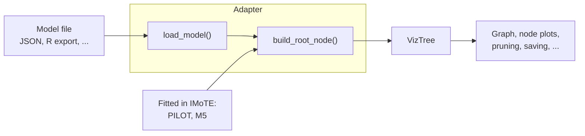

# Adapters

IMoTE can fit linear model trees itself with PILOT and M5 (see [New Tree](../user-guide/c-new-tree.md)), but many
other algorithms and implementations exist, often in other languages and each with its own output format and tree
structure. To support all of them, IMoTE converts every tree to one common representation, a
[`VizTree`](viztree_structure.md) object. All functionality of the application (drawing the graph, node plots, path
highlighting, prediction plots, collapsing, pruning, saving and loading) is built on this representation only.

An **adapter** is a small class that translates a fitted model into a `VizTree`. Supporting a new type of linear model
tree therefore only requires writing one adapter, the rest of the application doesn't change.

A model reaches its adapter in one of two ways:

- **Fitted in the application.** PILOT and M5 trees are fitted in the New Tree card, and the fitted model object is
  passed directly to the `Pilot` or `M5` adapter.
- **Loaded from a file.** A tree fitted elsewhere is exported to a file, which the adapter reads with `load_model`.
  This is how, for example, trees fitted with the R package partykit are loaded.

## In this section

1. [The VizTree object](viztree_structure.md): the structure an adapter has to build, with the available node types.
2. [The adapter interface](adapter_interface.md): the methods an adapter implements.
3. [Writing your own adapter](writing_an_adapter.md): a step-by-step guide.
4. [Example: the partykit adapter](partykit_example.md) a complete adapter for trees fitted in R.
