---
hide:
  - navigation
---

# Gallery

A visual tour of IMoTE. Every image is a screenshot of the full application, click an image to open it at full resolution.

!!! note "Version"
    These screenshots were taken with IMoTE **version 0.4.1**. If you use a different
    version, some details of the interface may look different.

---

## PILOT tree on BNG_echoMonths

The tree that IMoTE opens with: a PILOT tree fitted on the `1199_BNG_echoMonths`
dataset (30 nodes, depth 6).

### Default view

[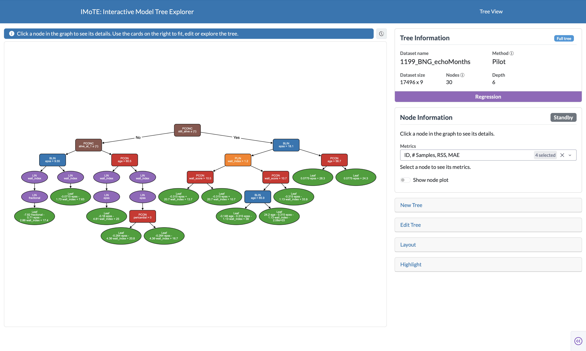](assets/gallery_screenshots/echo-default.png)

The tree as it appears when IMoTE starts, with **Normal** node size. Each node shows its
type (for example `PCONC`, `BLIN`, `LIN`) and its split or model, leaves show their
linear model.

### Minimal nodes

[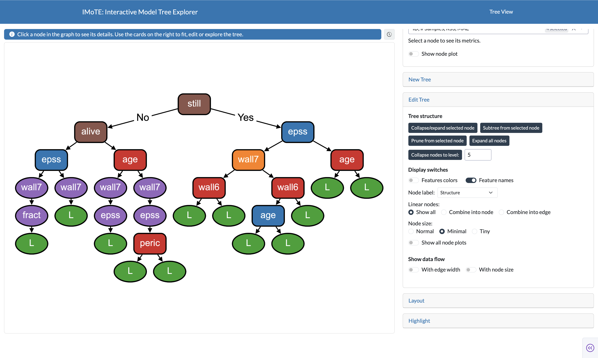](assets/gallery_screenshots/echo-minimal.png)

The same tree with **Minimal** node size: each node only shows the name of the feature
it uses, and leaves are labelled `L`. Node colors still indicate the node type.

### RSS as node label

[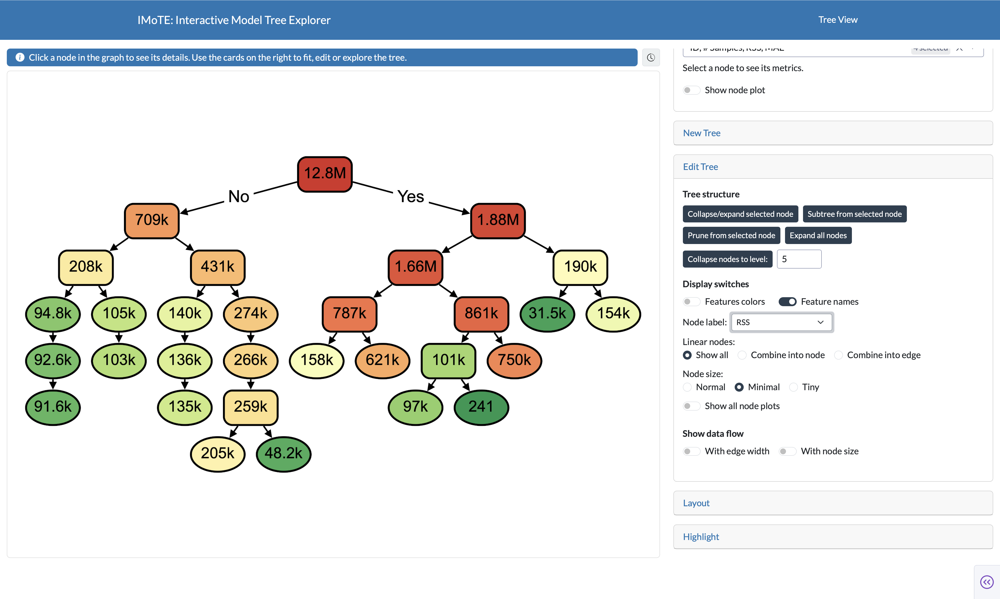](assets/gallery_screenshots/echo-rss.png)

Node label set to **RSS**. Each node shows its residual sum of squares and is colored
from red (high) to green (low), so you can see where the tree reduces the error most.

### Feature colors and data flow as edge width

[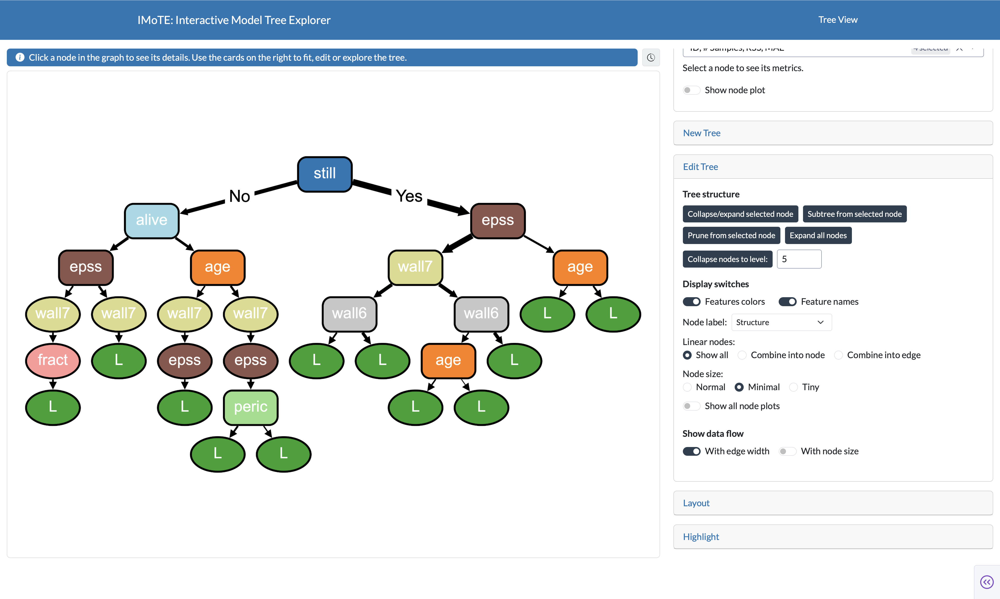](assets/gallery_screenshots/echo-colors-edge-width.png)

**Feature colors** give every feature its own color, so you can follow where the same
feature is used again. With **data flow as edge width**, thicker edges carry more
training samples.

### Feature colors and data flow as node size

[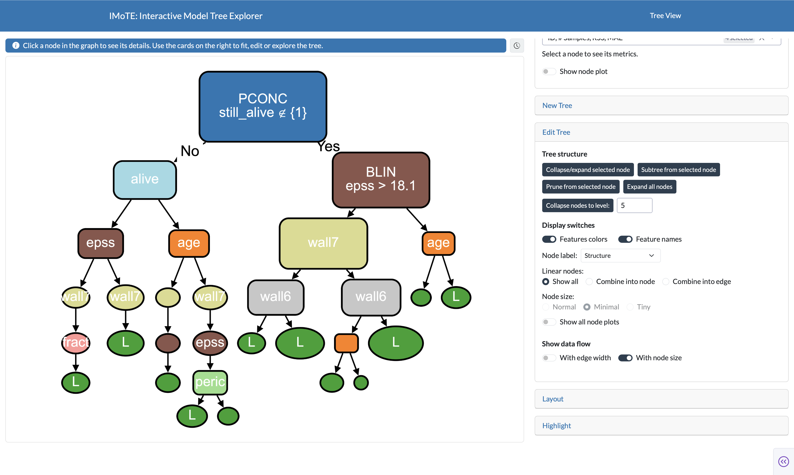](assets/gallery_screenshots/echo-colors-node-size.png)

Here the data flow is shown with **node size**: the bigger the node, the more training
samples reach it.

### Collapsed nodes and a highlighted path

[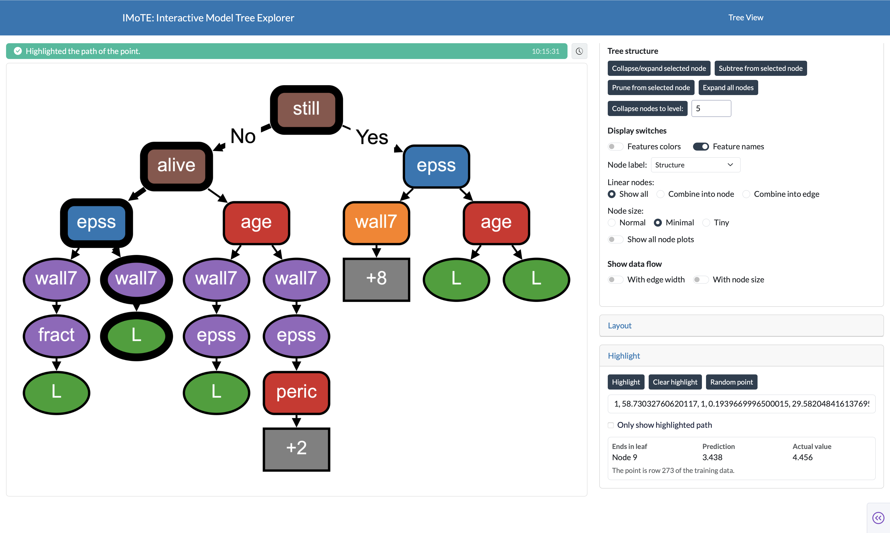](assets/gallery_screenshots/echo-collapsed-highlight.png)

Two subtrees are **collapsed** into grey boxes that show how many nodes are hidden
(`+8`, `+2`). One data point is **highlighted**: the thick black borders show the path it
takes to its leaf, and the Highlight card shows its prediction and actual value.

### Node plots pinned on the graph

[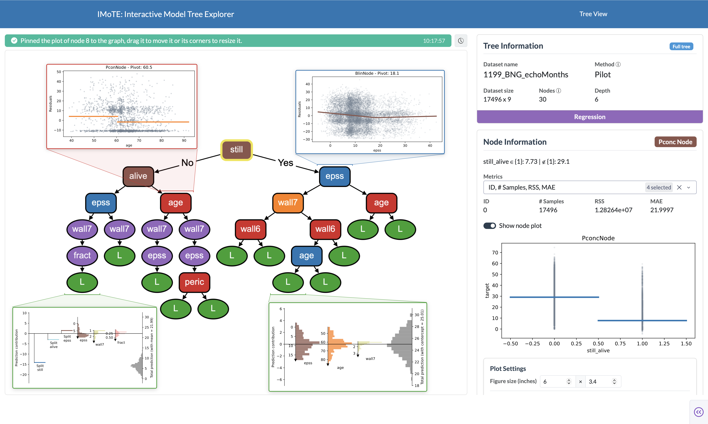](assets/gallery_screenshots/echo-pinned-plots.png)

The plots of four nodes (two internal nodes and two leaves) are **pinned to the graph**
next to their nodes. The root node is selected, and its plot and metrics appear in the
Node Information card.

### Left-to-right layout with highlight and pinned plots

[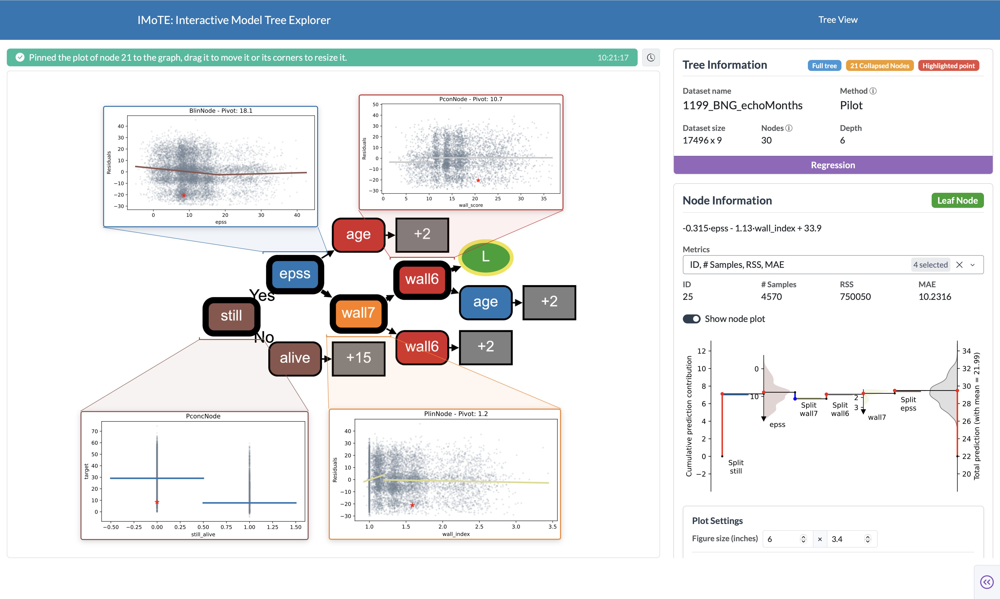](assets/gallery_screenshots/echo-left-right-highlight.png)

The tree drawn **left to right**, with several subtrees collapsed. A data point is
highlighted and the plots of the four internal nodes on its path are pinned to the graph,
the red star marks the point in each plot. The leaf at the end of the path is selected
and shows the **global prediction plot** with density estimates instead of histograms and
a staircase of how each node on the path adds to the final prediction of the highlighted point.

---

## PILOT tree on cpu_act

A new PILOT tree fitted on the `197_cpu_act` dataset (242 nodes, depth 23). Because the
tree is large, IMoTE automatically switches to **Tiny** nodes.

### Tiny nodes

[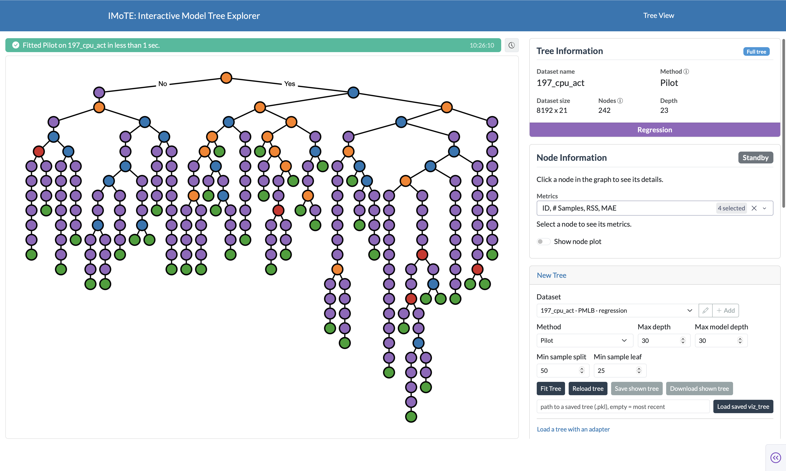](assets/gallery_screenshots/cpu-tiny.png)

The tree right after fitting. Tiny nodes are small circles colored by node type, which
keeps the overall shape of a large tree readable.

### Minimal nodes

[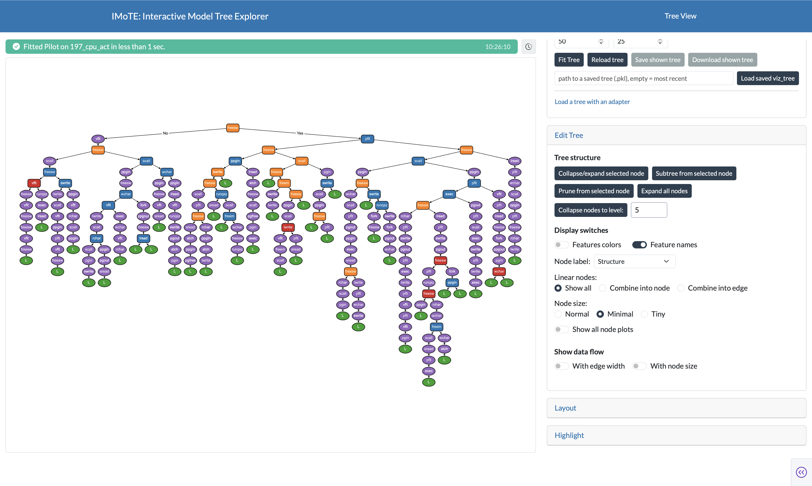](assets/gallery_screenshots/cpu-minimal.png)

The full tree with **Minimal** nodes, so the feature names become visible.

### Linear nodes combined into nodes

[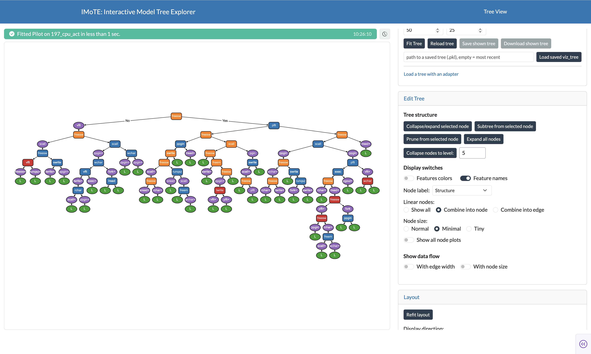](assets/gallery_screenshots/cpu-combine-node.png)

Minimal nodes with linear nodes **combined into the next node**. A `+` after a feature
name means linear steps were merged into that node.

### Linear nodes combined into edges

[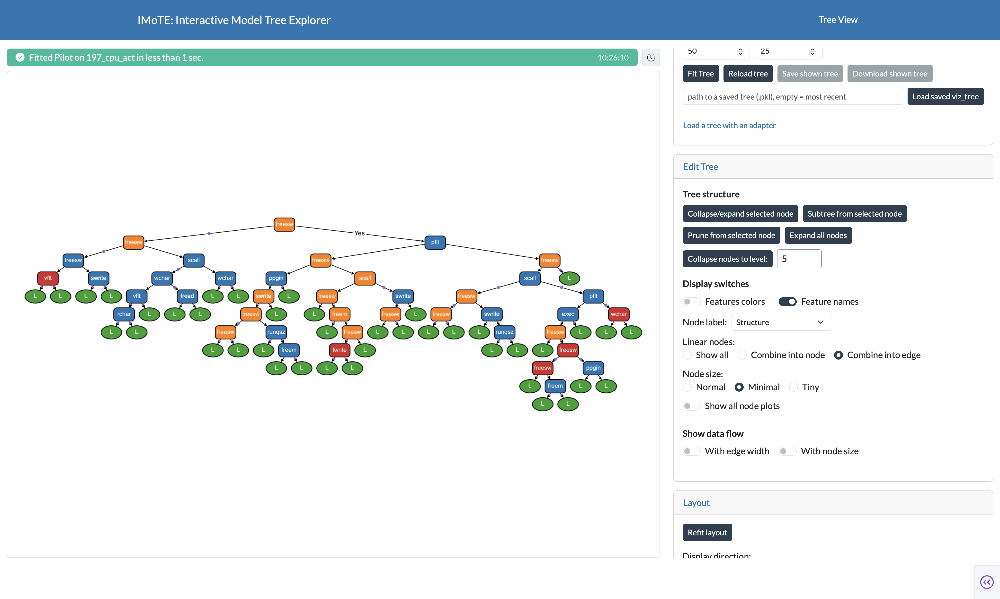](assets/gallery_screenshots/cpu-combine-edge.png)

Linear nodes **combined into the edge** instead: they appear as small dots on the edges,
so only split nodes and leaves remain as boxes.

### MSE as node label

[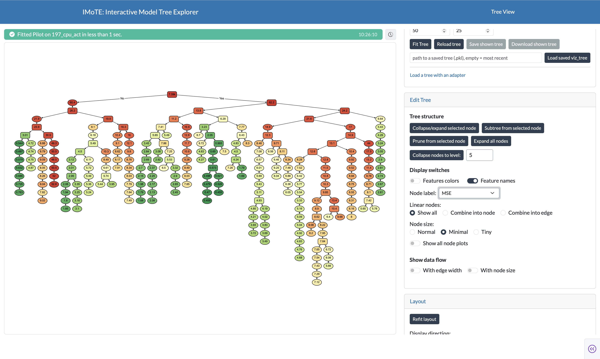](assets/gallery_screenshots/cpu-mse.png)

Node label set to **MSE**. The colors show how the mean squared error drops from the
root (red) towards the leaves (green).

### Feature colors and data flow

[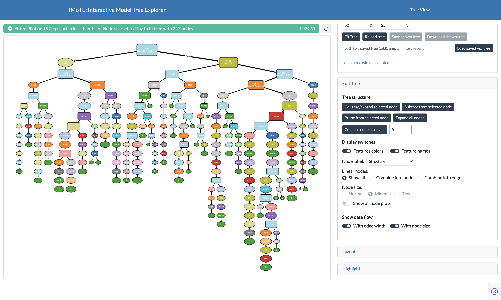](assets/gallery_screenshots/cpu-data-flow.png)

**Feature colors** with both data flow options on: **edge width** and **node size** show
how many training samples go through each part of the tree, so the main paths through a
large tree stand out.

---

## PILOT tree on no2

A small PILOT tree fitted on the `547_no2` dataset. IMoTE automatically uses **Normal**
nodes for a tree this size.

### Default view

[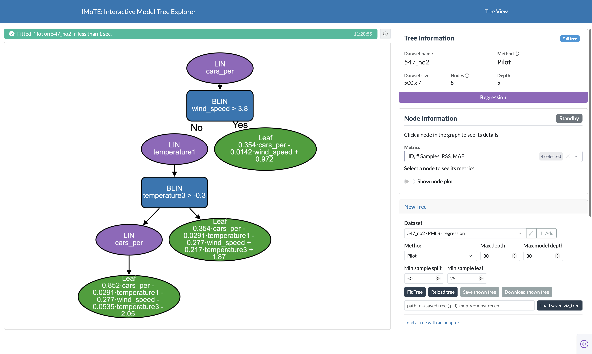](assets/gallery_screenshots/no2-pilot-default.png)

The PILOT tree right after fitting (8 nodes, depth 5). Linear (`LIN`) nodes and broken
linear (`BLIN`) splits alternate, and each leaf shows its full linear model.

### All node plots

[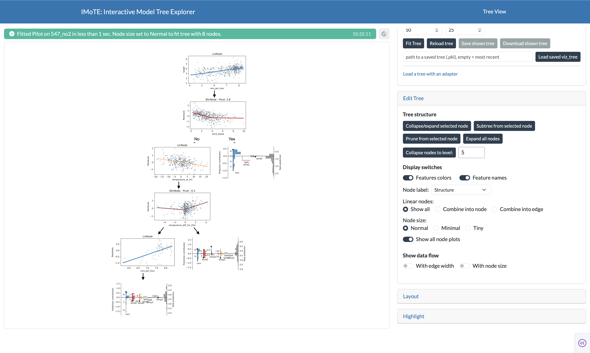](assets/gallery_screenshots/no2-pilot-node-plots.png)

With **Show all node plots** on, every node is replaced by its plot: the fitted model on
the residuals for internal nodes, and the global prediction plot for leaves.

---

## M5 tree on no2

An M5 tree fitted on the same `547_no2` dataset (7 nodes, depth 3), to show that IMoTE
works with other model tree methods as well.

### Default view

[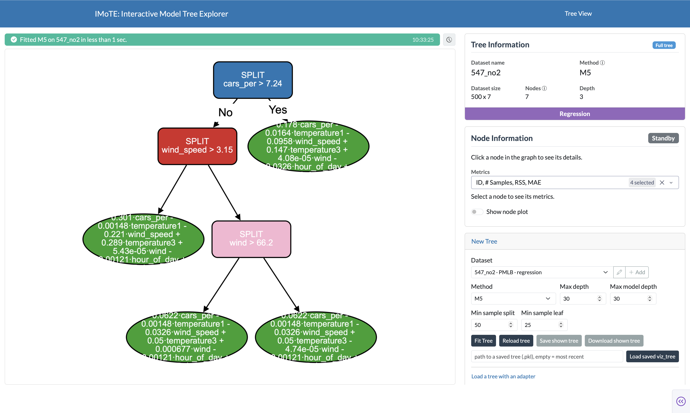](assets/gallery_screenshots/no2-m5.png)

The M5 tree right after fitting. Internal nodes are plain splits, and each leaf contains
a full linear model, making the leaf nodes too small to display it properly.

### All node plots

[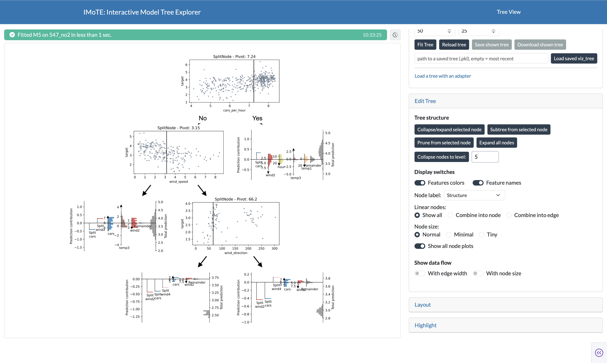](assets/gallery_screenshots/no2-m5-node-plots.png)

The same tree with **Show all node plots** on: scatter plots with the split value for
internal nodes, and the global prediction plot for each leaf.
