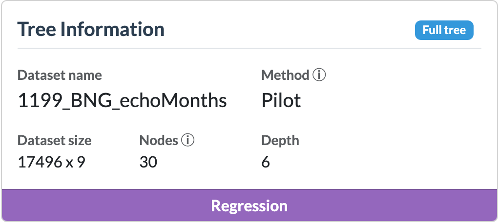

# Tree Information

The **Tree Information** card sits at the top and is always visible. It gives you a summary of the tree that's currently loaded.

## What it shows

Next to the title, the card displays several status badges that provide information about the currently displayed tree:

* Tree view – 
Indicates whether you are viewing: the full tree, a pruned tree, or a subtree rooted at an internal node.
* Collapsed nodes – 
Indicates how many nodes are collapsed in the tree, nodes that are collapsed are visually different.
* Highlighted point – 
Indicates whether a data point is currently highlighted.

Below the badges, the following information is shown:

* **Dataset name** – The name of the dataset used to fit the tree.
* **Method** – The algorithm used to fit the tree. On a hover it also shows:
    <small>
    * **Max depth** – The maximum model depth of the tree.
    * **Max model depth** – The maximum model depth of the tree without counting the linear models (PILOT only).
    * **Training time** – The time required to fit the tree.
    * **Min samples split** – The minimum number of training samples a node must contain before it is allowed to be considered for splitting.
    * **Min samples leaf** – The minimum number of training samples that each leaf must contain. A split is only performed if both resulting child nodes satisfy this constraint.

    </small>
  
* **Dataset size** the number of rows and the number of features in the training dataset.
* **Nodes** The number of total nodes in the tree, On a hover it also shows the split up into the number of leaf nodes and internal nodes.
* **Depth** The total depth of the tree (including linear nodes for the PILOT algorithm.) The root node is at depth 0. 

## When it updates

The card refreshes automatically whenever a new tree is fit, saved, or loaded via the [New Tree](c-new-tree.md) card.
