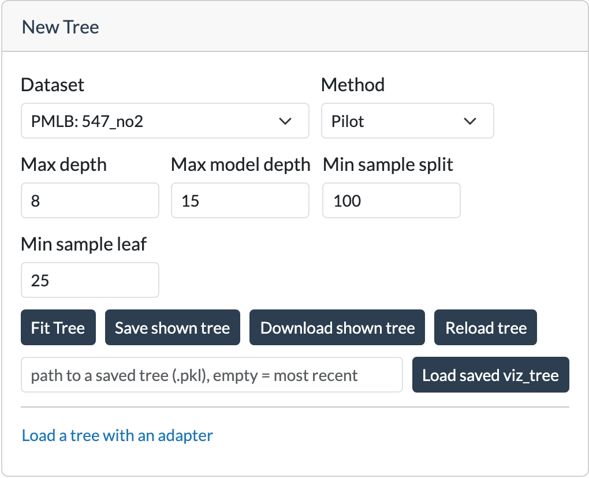

# New Tree

The **New Tree** card is used to fit a new model tree, to save and load previously fitted trees, or to load a tree with
an adapter.

<div style="max-width: 450px;" markdown="1">


</div>

## Fitting a tree

| Field                 | Description                                                                                                                                                       |
|-----------------------|-------------------------------------------------------------------------------------------------------------------------------------------------------------------|
| **Dataset**           | The dataset on which the tree will be fitted, chosen from your list of datasets (see [Datasets](#datasets) below). The pencil button opens the settings of the selected dataset, **Add** adds a dataset from PMLB, the UCI repository or a file. |
| **Method**            | The tree algorithm to use (see the [home](../index.md) page for a brief description of PILOT and M5).                                                             |
| **Max depth**         | The maximum depth of the tree. (The root node is at depth 0.)                                                                                                     |
| **Max model depth**   | PILOT only feauture: The maximum model depth, also counting linear nodes (max depth doesn't count linear nodes).                                                  |
| **Min samples split** | The minimum number of samples required before a node may be considered for splitting.                                                                             |
| **Min samples leaf**  | The minimum number of samples that each resulting leaf must contain.                                                                                              |

Click **Fit Tree** to train and show a new tree using the selected settings. Fitting may take a some time for larger
datasets or deeper trees.

## Saving and loading trees

The following actions are also available:

* **Save shown tree** – Saves the currently displayed tree as a pickled Python object in
  `~/.imote/saved_trees`. The saved tree can later be reloaded in the application.
* **Download shown tree** – Downloads the currently displayed tree as an SVG image, including the plots pinned on the
  graph.
* **Reload tree** – Restores the original fitted tree. This is useful after exploring subtrees or making temporary
  modifications to the visualization. The tree is restored to the state it had immediately after being fitted or loaded.
* **Load tree** – Loads a previously saved tree (pickled Python object). Enter the path to a saved tree in the text
  field and click **Load tree**. If the field is left empty, the application loads the most recently saved tree from
  `~/.imote/saved_trees`.

## Datasets

Every dataset you add is stored in its own folder in `~/.imote/datasets`. The list also suggests a few PMLB datasets, 
they are downloaded the first time a tree is fitted on them.

### Adding a dataset

<div style="max-width: 450px;" markdown="1">


</div>

Click **Add** next to the dataset dropdown, then:

* **PMLB**: search the [PMLB](https://epistasislab.github.io/pmlb/) datasets by name, optionally only classification or
  regression datasets. The number of rows, features and classes is shown for every dataset.
* **UCI repository**: search the [UCI Machine Learning Repository](https://archive.ics.uci.edu/) by name or id.
* **Upload a file**: CSV, TSV, TXT and UCI-style `.data` files (the separator and header row are detected), Excel
  (`.xlsx`, `.xls`), Parquet, Feather, ARFF and JSON. Parquet and Feather need `pyarrow`
  (`pip install imote[parquet]`), old `.xls` files need `xlrd` (`pip install imote[xls]`).

Clicking a search result downloads the dataset. Next, its settings are shown:

| Setting                  | Description |
|--------------------------|-------------|
| **Response**             | The column to predict. PMLB and UCI datasets fill this in from their metadata, for a file the last column (or a column called `target`) is proposed. |
| **Task**                 | Regression or classification, guessed from the response (text, or at most 10 whole numbers, is classification). With more than two classes the dataset is multiclass. |
| **Categorical features** | Text columns are always categorical. For some PMLB datasets the categorical columns are listed in `imote/benchmark_info.py`, otherwise numeric columns with fewer than 8 different values are proposed as categorical. |
| **Columns to leave out** | Columns that are not used as features, such as id columns. |

The box below the settings shows the result: the number of rows and features, the classes, how many rows are left out
and which methods can be used. Click **Save** to add the dataset to the list, or **Cancel** to abort.

!!! note
    Classification datasets can be added, but fitting classification trees isn't available yet: for such a dataset
    no method can be chosen.

Text columns are coded as numbers. Rows with a missing value (an empty cell, `NaN` or `?`) are left out.

### The dataset file

All settings are saved in `dataset.toml` in the folder of the dataset. You can edit this file by hand, for example
to change the order of the classes (for two classes the second one is the positive class) or of the categories, or to
leave out rows by removing a category.

```toml
name = "Abalone"
source = "uci"
source_id = 1
file = "data.tsv.gz"
response = "Rings"  # automatically detected (UCI metadata)
task = "regression"  # automatically detected
ignore = []

[read]
sep = "\t"
header = true

[categorical]
Sex = ["F", "I", "M"]  # automatically detected (UCI metadata)
```

The pencil button next to the dataset dropdown opens the same settings for a dataset on the list, there it can also be
removed (this deletes its folder).

## Using an adapter to upload a tree

The application also allows you to upload a linear model tree using an adapter. An adapter converts a tree from an
external implementation into the internal `VizTree` object used for visualization.
Currently, a tree can be loaded from a file for the _partykit_ package in R, which supports trees fitted using
`lmtree()`. PILOT and M5 trees are trained directly in the application.

The documentation page of the [adapter](../adapter/adapter_overview.md) explains how to implement your own adapter, allowing trees from other linear model tree
algorithms in different languages to be imported. It also provides more details on the partykit adapter.

### Using an Adapter
* Select the desired adapter from the dropdown.
* Select the dataset used to fit the tree. You can add the dataset (or a sample) as a file.
* Provide the **path to the model** or file containing the tree information.
* Click on **Load with Adapter**.
