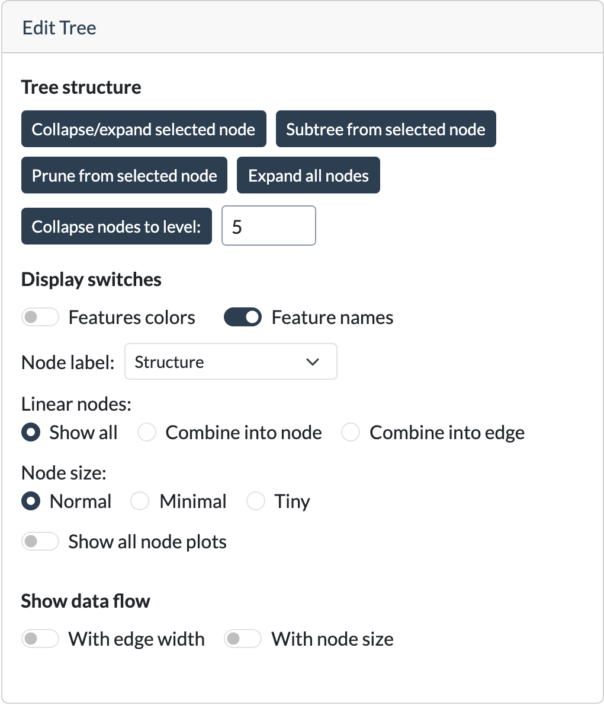

# Edit Tree

The **Edit Tree** card controls how the tree is structured and displayed in the graph — it doesn't change the underlying fitted model, only what you see.

## Tree structure

These buttons determine which parts of the tree are currently visible.

| Button                            | Description                                                                                                                                                                                                                      |
|-----------------------------------|----------------------------------------------------------------------------------------------------------------------------------------------------------------------------------------------------------------------------------|
| **Collapse/Expand selected node** | Toggles whether the children of the currently selected internal node are visible. An internal or collapsed node must be selected.                                                                                                |
| **Subtree from selected node**    | Look at the subtree rooted at the selected node. The rest of the tree is removed (and can be reloaded by using the reload tree button in [new tree](c-new-tree.md#saving-and-loading-trees)). An internal node must be selected. |
| **Expand all nodes**              | Expands all previously collapsed nodes in the tree                                                                                                                                                                               |
| **Collapse nodes to level: N**    | Collapses the tree so that only the first N levels remain. Linear (non-splitting) nodes count as a level too.                                                                                                                     |

## Display switches

These controls change how the nodes and edges of the tree are displayed.

| Switch                             | Description                                                                                                                                                                                                                                 |
|------------------------------------|---------------------------------------------------------------------------------------------------------------------------------------------------------------------------------------------------------------------------------------------|
| **Linear nodes**                   | Controls how chains of linear nodes are displayed in PILOT trees. Available options are **Show all** (each as its own node), **Combine into node** (merged into a single node), or **Combine into edge** (merged into the connecting edge). |
| **Node label**                     | What the nodes show. **Structure** shows the split or model of each node. Choosing a metric shows only its value in every node and colors the nodes on a gradient. |
| **Node size**                      | Controls the size of the displayed nodes. Availible options are **Normal** (show full size with split information), **Minimal** (show smaller nodes with only feature information), or **Tiny** (nodes gets represented as colorded dots).  |
| **Show all node plots**            | Displays the [node plot](b-node-info.md#node-plots) for every node simultaneously instead of only for the selected node. This can take some time for large trees or big datasets.                                                           |
| **Feature colors**                 | Colors nodes according to the feature associated with that node, rather than by node type. These colors are used consistently throughout the application, including in the [node plots](b-node-info.md#node-plots).                         |
| **Feature names**                  | Uses the feature names of the dataset in the node labels. When off, or when the dataset has no names, the labels use X0, X1, ...                                                                                          |
| **Show data flow with edge width** | Adjust the thickness of the edges to show the number of datapoints that go trough that edge.                                                                                                                                                |
| **Show data flow with node size**  | Adjust the size of the node to show the number of datapoints that are in that node.                                                                                                                                                         |

Some combinations of options are not possible, which is adjusted for automatically.
