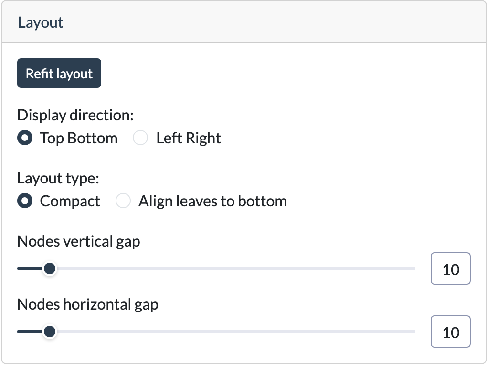

# Layout

The **Layout** card controls how the tree graph is arranged on screen. It doesn't affect the tree's structure or data, only the drawing.

## Controls

| Control                  | Description                                                                                                     |
|--------------------------|-----------------------------------------------------------------------------------------------------------------|
| **Refit layout**         | Puts all nodes back in place and fits the tree in the view, useful after dragging things around or zooming     |
| **Display direction**    | **Top Bottom** or **Left Right** - the direction the tree grows in                                              |
| **Layout type**          | **Compact** keeps every node right below its parent, **Align leaves to bottom** puts all leaves on the last level |
| **Nodes vertical gap**   | Spacing between tree levels, 0 puts the levels right against each other                                         |
| **Nodes horizontal gap** | Spacing between nodes next to each other on the same level                                                      |

## How the tree is laid out

The graph uses a tidy tree layout, made for trees:

- The left child of a split ("No") is always on the left, the right child ("Yes") on the right.
- Every node is centred above its children, a chain of linear nodes goes straight down.
- Subtrees are pushed together as close as they fit, nodes never overlap and edges don't run through other nodes.
- With **Align leaves to bottom**, the edge to a leaf bends at the level where the leaf would be in the compact layout and
  then goes straight down.

